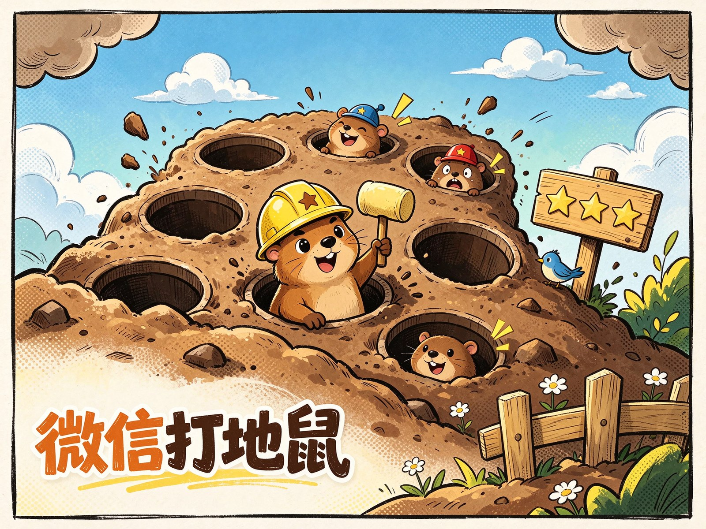

<p align="center"></p>

<h1 align="center">微信打地鼠</h1>

<p align="center">3×3 地洞、随机冒头、点击得分的小程序休闲小游戏</p>

<p align="center">
  <a href="http://mole.aikex.ink/">在线试玩</a> ·
  <a href="https://github.com/aiyangdie/wechat-whack-a-mole">源码仓库</a>
</p>

## 简介

基于微信小程序原生框架开发的打地鼠小游戏。地鼠从 3×3 的洞里随机冒出，出现时长与间隔都会变化，点得越快分越高。视觉上是渐变天空、飘动白云、浮动太阳，配背景音乐与击打音效。

## 功能

- **经典玩法**：3×3 网格，地鼠随机出现，点击 +1 分
- **随机节奏**：地鼠停留 800–1500 ms 随机变化，难度自然浮动
- **音效系统**：背景音乐 + 击打音效 + 开始音效，可一键静音
- **最高分记录**：本地持久化，重开小程序也能接着挑战
- **动画细节**：地鼠弹跳出现、按钮光泽、云朵飘动

## 技术栈

微信小程序原生框架（WXML / WXSS / JS Component）· `wx.createInnerAudioContext` 音频 · `wx.setStorageSync` 存储 · 基础库 ≥ 2.19.4

## 快速开始

```bash
git clone https://github.com/aiyangdie/wechat-whack-a-mole.git
```

1. 打开[微信开发者工具](https://developers.weixin.qq.com/miniprogram/dev/devtools/download.html)
2. 「导入项目」指向仓库根目录，填 AppID 或选测试号
3. 点「编译」在模拟器里预览，点「预览」扫码上手机

## 项目结构

```
app.js / app.json            入口与全局配置
pages/index/                 游戏页（逻辑、模板、样式）
  index.js                   核心玩法（Component 封装）
audio/                       背景音乐、击打、开始音效
images/mole.png              地鼠素材
```

## 玩法

点「开始游戏」→ 地鼠随机冒出 → 快速点击得分 → 停留时间随机，越快越好 → 挑战最高分。

## 许可证

仓库未附 LICENSE 文件，使用与分发请先联系作者确认。
